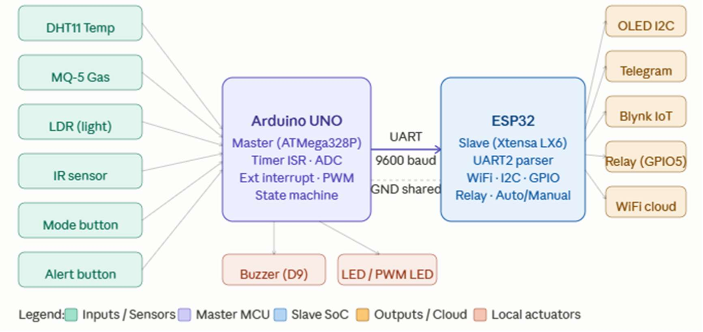
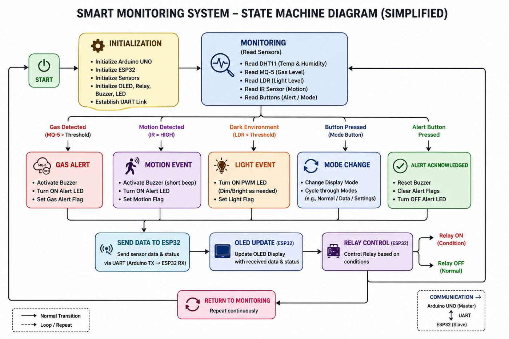
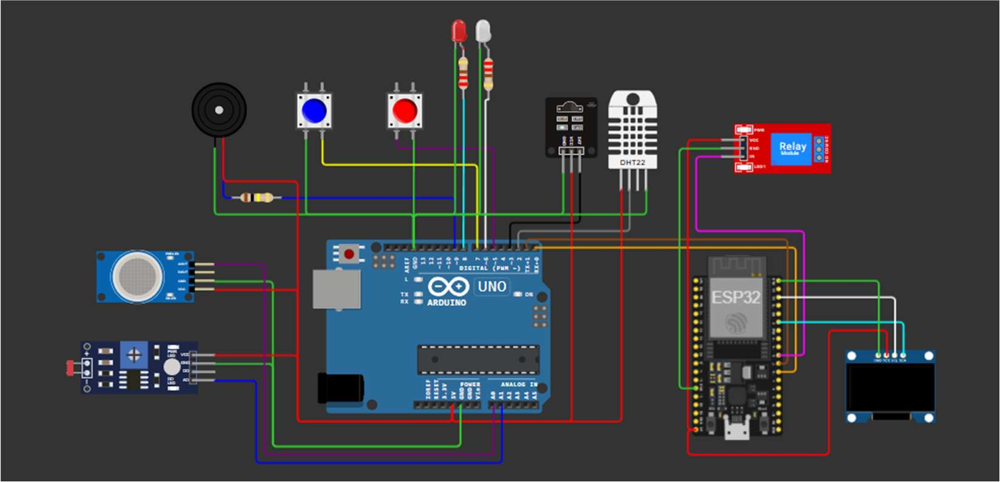

# IoT Industrial Safety Monitoring System (Arduino UNO + ESP32)

Low-cost safety monitor that detects fire, gas leaks and intruders, with alerts on an OLED screen, Telegram and the Blynk app.

---

## Problem

Factories and workshops need constant monitoring for fire, gas leaks and unauthorised access. Commercial systems cost RM300–800 and usually only sound a local buzzer.

## Features

- **Monitors** temperature (DHT11), gas (MQ-5), light (LDR) and intrusion (IR sensor)
- **System states:** SAFE, WARNING, FIRE, INTRUDER
- **3 operating modes:** Normal, Power Saving, Emergency
- **4 alert channels:** buzzer, LED, Telegram, Blynk app
- **Smart intrusion detection:** in Normal mode it only triggers in the dark, which cuts false alarms during working hours
- **Relay control:** automatic, or manual from Blynk, with auto-reset back to automatic once the status returns to SAFE
- **Cost:** about RM120–150 in components

## How It Works

1. **Arduino UNO (master)** reads all sensors and decides the system state
2. It sends the data to the ESP32 over UART as a CSV line (9600 baud)
3. **ESP32 (slave)** checks and parses the data
4. The ESP32 updates the OLED, Blynk dashboard and Telegram, and controls the relay
5. If no data arrives for 10 seconds, the OLED shows "NO SIGNAL"

## Hardware

- Arduino UNO, ESP32
- DHT11, MQ-5 gas sensor, LDR, IR sensor
- OLED display (I2C), relay module, buzzer, LEDs

## Tech Stack

- Arduino C++
- UART serial protocol (custom CSV frame)
- Blynk IoT
- Telegram Bot API

## Files

- `firmware/slave_esp32/slave_esp32.ino`: ESP32 firmware (UART parsing, OLED, Blynk, Telegram, relay). Fill in your Blynk, Wi-Fi and Telegram details.

## Project Info

- **Course:** Embedded System Applications, Politeknik Ungku Omar

## Future Improvements

- XOR checksum on UART frames for error checking
